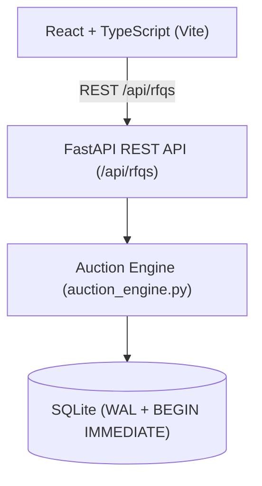
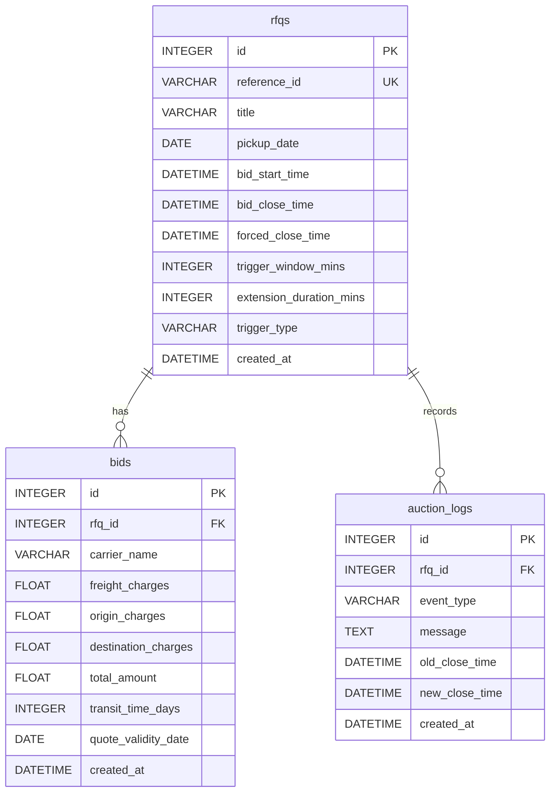

# British Auction RFQ System

A reverse auction system for freight procurement implementing dynamic **British auction extensions**. If competitive bidding occurs within a configurable trigger window ($X$ minutes before closing), the auction automatically extends by $Y$ minutes, capped at an absolute forced close ceiling.

## Architecture



### Key Technical Design
- **Dynamic Status**: RFQ status (`UPCOMING`, `ACTIVE`, `CLOSED`, `FORCE_CLOSED`) is computed dynamically from current UTC time rather than stored statically, avoiding stale state.
- **Concurrency Control**: SQLite runs in Write-Ahead Logging (`WAL`) mode. Bid submissions issue `BEGIN IMMEDIATE` on transaction begin to serialize concurrent last-second writes.
- **Tie-Breaker Ranking**: Bids are ranked by `total_amount ASC` ($L_1, L_2, \dots$). Exact price ties are broken by earlier `created_at ASC`.
- **Extension Formula**: $\min(\text{bid\_close\_time} + Y, \text{forced\_close\_time})$. Supported triggers: `L1_CHANGE` (new lowest price), `BID_RECEIVED` (any bid in window), and `ANY_RANK_CHANGE` (displacement on leaderboard).

## Database Schema



## API Endpoints

| Method | Endpoint | Description |
| :--- | :--- | :--- |
| `GET` | `/api/rfqs` | List all RFQs with status, current $L_1$ bid, and bid count (supports `?status=` and `?search=`) |
| `POST` | `/api/rfqs` | Create a new RFQ with timing and extension parameters |
| `GET` | `/api/rfqs/{id}` | Get RFQ details with ranked bids ($L_1, L_2, \dots$) and activity logs |
| `POST` | `/api/rfqs/{id}/bids` | Submit a carrier quote and evaluate time extension |
| `GET` | `/api/health` | Health check endpoint |

## Setup & Running Locally

### Backend (FastAPI)

```bash
# Setup virtualenv and install dependencies
python3 -m venv backend/venv
source backend/venv/bin/activate
pip install -r backend/requirements.txt

# Seed sample RFQs
PYTHONPATH=backend python3 backend/seed.py

# Run FastAPI server (runs on http://127.0.0.1:8000)
PYTHONPATH=backend uvicorn app.main:app --reload --port 8000
```

### Running Tests

```bash
PYTHONPATH=backend backend/venv/bin/pytest backend/tests/test_auction.py -v
```

### Frontend (React + Vite)

```bash
cd frontend
npm install
npm run build   # verify type check & production build
npm run dev     # runs on http://localhost:5173
```
